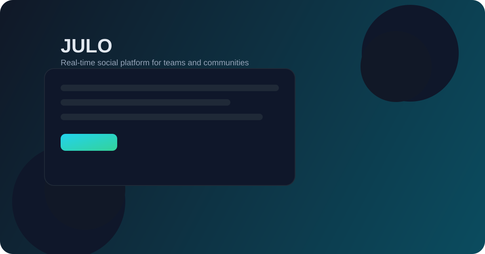

<div align="center">

# ⚡ JULO

### Real-time social platform for communities and teams

**Share updates, chat instantly, call face-to-face and stay in sync, all in one place.**


<br/>




</div>

---

## 📑 Table of Contents
- [Overview](#-overview)
- [Features](#-features)
- [Architecture](#%EF%B8%8F-architecture)
- [Tech Stack](#-tech-stack)
- [Getting Started](#-getting-started)
- [Environment Variables](#-environment-variables)
- [Scripts](#-scripts)
- [API Docs](#-api-documentation)

---

## 📖 Overview

**JULO** is a full-stack, production-oriented social platform. It combines a social **feed**, **stories**, **real-time messaging**, **voice and video calls** and **live notifications** in one app. The backend uses a layered service architecture backed by MongoDB, Redis and BullMQ, and it is containerised, tested and documented with OpenAPI.


## ✨ Features

### 📰 Social
- Feed with **posts, comments, likes, shares, bookmarks and replies**
- Quote-echo (quote posts) and **link previews** (Open Graph scraping)
- **Stories** rail with viewer feedback
- **Follow system** with suggestions
- Privacy settings, blocking, reporting and **content moderation**

### 💬 Messaging
- One-to-one and **group chats** with group details management
- **Typing indicators, reactions, replies, threads, edit and delete**
- Rich messages: **images, files, voice notes** (waveform UI), emoji picker
- Virtualised message lists (`react-window`) and an offline banner
- End-to-end encryption groundwork: identity keys, signed pre-keys, one-time pre-keys and key-exchange sessions

### 📞 Calls
- **WebRTC voice and video calls** with incoming and outgoing call modals
- Participant grid, call controls, call timer and **picture-in-picture**
- ICE/TURN support (coturn compose file), call history and recordings

### 🔔 Platform
- **Real-time notifications** queued with BullMQ, plus push tokens and per-user preferences
- **Stripe billing** with webhook handling
- Multi-tenancy, RBAC, consent tracking and **audit logs**
- Idempotency keys, a circuit breaker and **Redis-cached** queries (feed, profile, search)
- Per-user **rate limiting** (Redis sliding window)

## 🏗️ Architecture

```
                ┌──────────────────────────┐
                │  React 19 + Vite client  │
                │ Redux Toolkit · Tailwind │
                └────────────┬─────────────┘
                   REST /api/v1 │ Socket.IO │ WebRTC
                ┌────────────▼─────────────┐
                │  Express 5 API (Node 22) │
                │ controllers → services → │
                │   models (Mongoose)      │
                └───┬───────────┬──────────┘
                    │           │
             ┌──────▼───┐  ┌────▼────────────────┐
             │ MongoDB  │  │ Redis               │
             │          │  │ cache · rate limit  │
             └──────────┘  │ Socket.IO adapter   │
                           │ BullMQ queues ──▶ worker
                           └─────────────────────┘
```

```
client/          React 19 SPA (pages, chat & call components, Redux store, API layer)
server/
  config/        env, MongoDB, Redis, Cloudinary
  controllers/   Thin HTTP handlers
  services/      Business logic (auth, posts, chat, calls, billing, crypto, notifications…)
  models/        Mongoose schemas
  middlewares/   auth, rbac, cache, idempotency, circuit breaker, audit, tenant, upload
  queues/        BullMQ notification & email jobs + worker
  utils/         AppError, validation, logger, error handler, socket
docs/            OpenAPI spec & assets
.github/         CI workflow
```

## 🧰 Tech Stack

| Layer | Technology |
|---|---|
| **Frontend** | React 19, Vite, Tailwind CSS 4, Redux Toolkit, Framer Motion, Radix UI, Socket.IO client, emoji-mart |
| **Backend** | Node.js 22, Express 5, Zod, JWT, bcrypt |
| **Database** | MongoDB (Mongoose) |
| **Cache / Queue** | Redis + BullMQ |
| **Real-time** | Socket.IO (Redis adapter for horizontal scaling), WebRTC |
| **Media** | Cloudinary (Multer) |
| **Payments** | Stripe |
| **Security** | Helmet, express-rate-limit, Zod validation, RBAC |
| **Observability** | Winston JSON logs, request tracing, Prometheus metrics |
| **DevOps** | Docker, Docker Compose, Nginx, GitHub Actions CI |
| **Testing** | Jest, Supertest |

## 🚀 Getting Started

### With Docker (recommended)
```bash
git clone https://github.com/Mohamedd-Ayyman/JULO.git
cd JULO
cp server/.env.example server/.env    # set SECRET_KEY and CONN_STRING
cp client/.env.example client/.env
docker compose up -d                  # MongoDB + Redis + Server + Client
```

### Without Docker
```bash
cd server && npm install && npm run dev
cd client && npm install && npm run dev
```

### Production
```bash
docker compose -f docker-compose.prod.yml up -d
```

## 🔐 Environment Variables

| Variable | Description | Required |
|---|---|---|
| `PORT_NUMBER` | Server port (default `3000`) | ✅ |
| `CONN_STRING` | MongoDB connection string | ✅ |
| `SECRET_KEY` | JWT signing secret (64+ chars) | ✅ |
| `CLIENT_URL` | Frontend URL for CORS | ✅ |
| `REDIS_URL` | Redis URL; features degrade gracefully without it | – |
| `JWT_EXPIRES_IN` | Token expiry (default `7d`) | – |
| `CLOUDINARY_*` | Image upload credentials | – |

## 📜 Scripts

| Command | Description |
|---|---|
| `npm run dev` | Server with nodemon |
| `npm start` | Server in production mode |
| `npm run worker` | BullMQ worker (separate process) |
| `npm test` / `npm run test:coverage` | Test suite / with coverage |
| `npm run seed` | Seed test users |

## 📚 API Documentation

- **Swagger UI:** `/api/docs`
- **OpenAPI spec:** `docs/openapi.yaml`
- **Health:** `/api/v1/health` · **Metrics:** `/api/v1/metrics`

## 👤 Author

**Mohamed Ayman**, Frontend / Full-Stack Developer · [GitHub](https://github.com/Mohamedd-Ayyman) · [LinkedIn](https://linkedin.com/in/mohamed-ayman-8787b0269)
